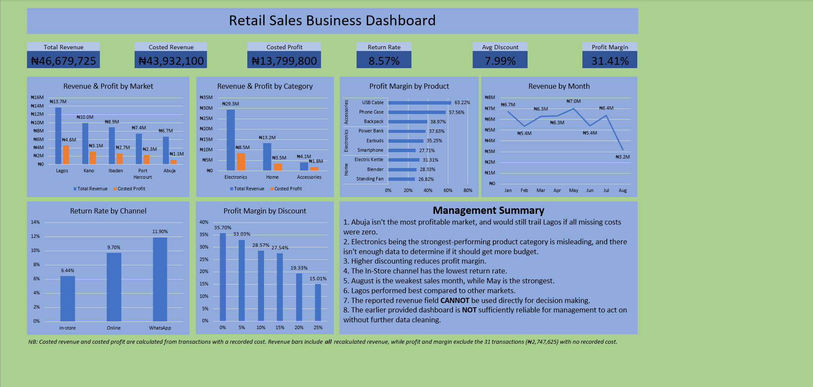

# Retail Sales Dashboard Audit

A retail dashboard that looked ready for management turned out to be wrong on six of its seven specific claims and misleading on the seventh — starting with the market management called the most profitable, which is actually the weakest.

**Tool(s):** Microsoft Excel &nbsp;·&nbsp; **Type:** OIT Capstone Project &nbsp;·&nbsp;   **Dataset:** Created by the DSN AI Bootcamp 2026 and provided by Othello Institute of Technology (retail transactions across five Nigerian markets)

---

## Preview

---

## Overview

This is the capstone of the Data Analysis track at Othello Institute of Technology, using a challenge originally created by the DSN AI Bootcamp 2026 for its Data Analytics track. Management had already received a dashboard and a set of conclusions built on a raw dataset of 432 retail transactions; the task was to audit the data, test each claim, and rebuild a dashboard management could trust. The corrected dashboard is built in Excel from 420 cleaned transactions, and every claim is answered in the accompanying submission sheet.

---

## A Note on Scope

These findings describe this 420-transaction dataset, not retail in general. Profit is not reduced for returns, so Electronics, which has the highest return rate, may be less profitable than shown. The dataset also holds no spend or demand data, so it cannot show whether discounts win extra customers or whether extra budget would pay off. Abuja's corrected margin rests on 75% of its transactions, which makes it the least certain figure in the analysis.

---

## Key Findings

1. **Four data problems distorted the original figures.** 12 exact duplicate transactions added ₦1,130,900 to revenue; 22 revenue values disagreed with Units × Price × (1 − Discount), 15 understated by ₦377,280 and 7 overstated by ₦67,525; 31 transactions (₦2,747,625 of revenue) had no recorded cost; and Lagos and Accessories were split across several spellings. Corrected revenue is ₦46,679,725, which is 1.76% below the ₦47,500,870 the original data implied.
2. **Abuja is the weakest market, not the strongest.** With blank costs treated as zero, Abuja showed a 48.00% margin, the highest of the five. On recorded costs its profit is ₦1,143,375 at a 24.75% margin, the lowest, while Lagos leads with ₦4,579,900 and 33.45%. Even if all 20 of Abuja's missing costs were zero, its profit would reach only ₦3,208,300, still below Lagos.
3. **Deeper discounts erode profit rather than build it.** Margin falls at every level, from 35.70% with no discount to 15.01% at 25% off. Discounts cost ₦3,341,400 on costed sales, equal to 24% of profit.
4. **Electronics is the largest category but not the strongest.** It brings in 62.9% of revenue (₦29,346,500) at a 30.70% margin, against 46.80% for Accessories, and has the highest return rate at 11.86% versus 4.59% for Accessories.
5. **Two more claims fail on the numbers.** In-store, not Online, has the lowest return rate (6.44% versus 9.70%), and August is the weakest sales month (₦3.17M) while May is the strongest (₦7.01M).
6. **Product mix and discount depth drive margin more than location does.** Margin ranges from 26.82% to 63.22% across products and from 15.01% to 35.70% across discount tiers, against 24.75% to 33.45% across markets and 29.29% to 32.53% across sales reps.

Taken together, the original dashboard's real weakness was not one bad chart but that nothing on it showed how much rested on unstated assumptions: six of the seven claims were incorrect and one misleading, including all four statements in its own management summary. The corrected figures point toward three actions: control discounting above 15% (a review point, not a proven optimum), rebalance the product mix and investigate Electronics returns before adding budget, and recover the missing costs, starting with Abuja. The submission sheet sets out the full reasoning for each claim.

---

## Data Integrity / Methodology

The hardest call was the 31 transactions with no cost. The original dashboard treated every blank as zero, so each sale's full revenue counted as profit, a 100% margin on ₦2,747,625. Simply dropping those rows was not enough either: dividing the remaining profit by all revenue would have understated Abuja's margin at 17.11%, because its revenue included the uncosted sales. Estimating the costs would have added an assumption the data does not support.

Instead, blanks were treated as unknown. A `Cost_Missing` flag and a `Revenue_Costed` column were added, profit was calculated only where a cost exists, and margin was defined as profit divided by the revenue of those same costed transactions (₦43,932,100). The exclusion is stated on the dashboard so its size is visible. The correction moved total profit from ₦16,547,425 to ₦13,799,800, overall margin from 35.45% to 31.41%, and Abuja's margin from the highest of five markets to the lowest.

---

## What's Inside

| File | Description |
|------|-------------|
| [`DSNxOthello_Project.xlsx`](DSNxOthello_Project.xlsx) | Full workbook containing the corrected dashboard and supporting analysis sheets. |
| [`Data_Analytics_Track_Submission_Form.md`](Data_Analytics_Track_Submission_Form.md) | Completed submission sheet: data-cleaning review, verdict on each management claim, and final analysis answers. |
| [`1_overview.png`](1_overview.png) | Corrected dashboard overview. |

---

## How to View

Download `DSNxOthello_Project.xlsx` and open it in Microsoft Excel (2016 or later recommended). The dashboard sheet shows the corrected view, and the analysis sheets hold the PivotTables behind it (`Sheet2` specifically). Read the submission sheet alongside it for the reasoning behind each cleaning decision and verdict.

---

*The scenario, raw dataset and original management dashboard were created by the DSN AI Bootcamp 2026 for its Data Analytics track and provided by Othello Institute of Technology as my track capstone. The audit, data cleaning, corrected dashboard and all conclusions are my own work.*
